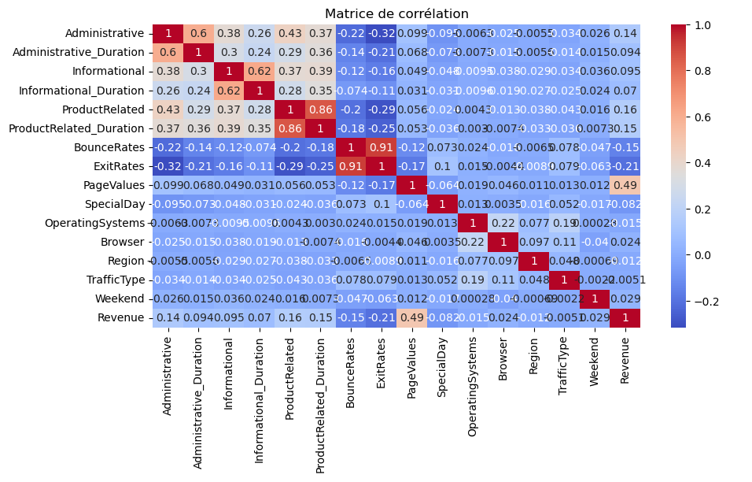
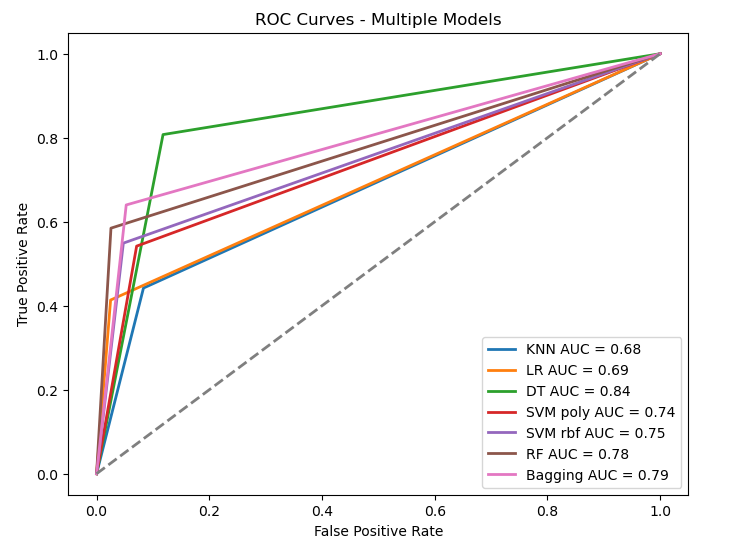
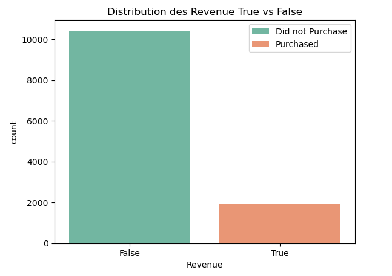
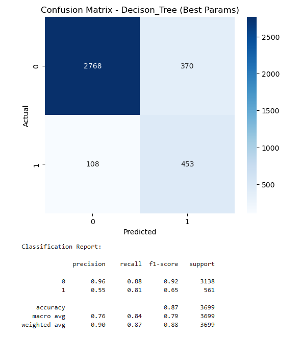
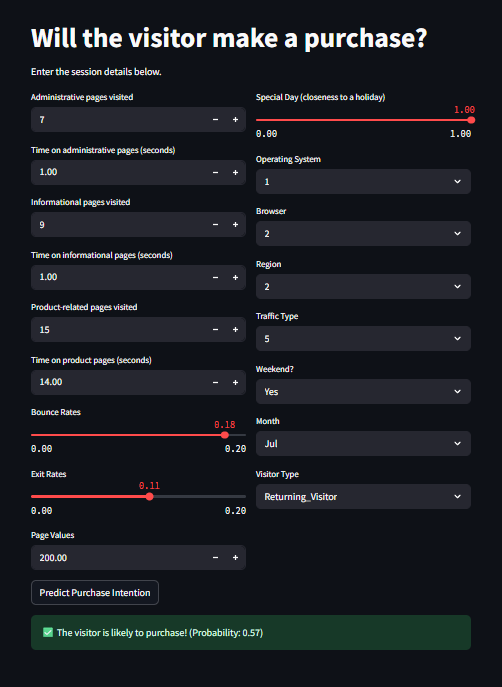

# Online Shoppers Purchase Intention Prediction


**Business question:** can we tell, from how a visitor browses an e-commerce site, whether the session will end
with a purchase?

Only about 15% of sessions convert. Spotting high-intent visitors early lets a business target them with offers,
personalize the experience and spend its advertising budget on the visitors most likely to buy.
This project compares seven classification models and ships the selected one in a Streamlit app.

## Data
[Online Shoppers Purchasing Intention dataset](https://archive.ics.uci.edu/dataset/468/online+shoppers+purchasing+intention+dataset)
(Sakar & Kastro, UCI Machine Learning Repository, 2018; also on Kaggle): **12,330 sessions** from one year of an online
store, 17 features, no missing values.

| Group | Features |
|---|---|
| Pages visited and time spent | `Administrative`, `Informational`, `ProductRelated` and their `_Duration` |
| Engagement metrics (Google Analytics) | `BounceRates`, `ExitRates`, `PageValues` |
| Context | `SpecialDay`, `Month`, `Weekend`, `VisitorType`, `TrafficType`, `Region`, `Browser`, `OperatingSystems` |
| **Target** | `Revenue`: True if the session ended with a purchase (1,908 True / 10,422 False) |

## Method
1. **Data quality checks:** types, missing values, inconsistent rows (pages = 0 but duration > 0).
2. **Exploratory analysis:** class balance, conversion by visitor type and month, correlations, `PageValues` vs purchase.
3. **Preparation:** label encoding (`Revenue`, `Weekend`), one-hot encoding (`Month`, `VisitorType`),
   70 / 30 train-test split, standardization.
4. **Models:** Logistic Regression, KNN, SVM (RBF and polynomial kernels), Decision Tree, Random Forest and Bagging,
   tuned with `GridSearchCV` / `RandomizedSearchCV`.
5. **Evaluation:** confusion matrix, precision, recall and F1 on the purchase class, ROC curves, 10-fold cross-validation.
6. **Deployment:** the selected model and its preprocessing objects are saved and served in a Streamlit app.

Because classes are imbalanced, accuracy alone is misleading: predicting "no purchase" for everyone is already 85%
accurate. The comparison therefore focuses on **recall and F1 for buyers**.

## Results
Test set: 3,699 sessions, including 561 purchases.

| Model | Accuracy | Precision (buyers) | Recall (buyers) | F1 (buyers) |
|---|---|---|---|---|
| Logistic Regression | 0.89 | 0.75 | 0.41 | 0.53 |
| KNN (k = 5) | 0.88 | 0.68 | 0.35 | 0.46 |
| SVM, RBF kernel, tuned | 0.89 | 0.67 | 0.55 | 0.61 |
| SVM, polynomial kernel, tuned | 0.87 | 0.58 | 0.54 | 0.56 |
| **Decision Tree, tuned for recall** | 0.87 | 0.55 | **0.81** | 0.65 |
| Random Forest, tuned | **0.92** | **0.80** | 0.58 | **0.68** |
| Bagging (decision trees) | 0.90 | 0.69 | 0.64 | 0.66 |

- **Selected model: Decision Tree.** It finds **81% of buyers**, far more than any other model, which is the goal when
  the cost of missing a buyer is higher than the cost of a false alarm (for example, showing a discount).
- **Random Forest** has the best accuracy and F1. It would be the choice if precision mattered more (for example,
  when each contacted visitor costs money).
- **`PageValues` is the strongest signal:** visitors who reach high-value pages are much more likely to buy;
  new visitors convert more often than returning ones (25% vs 14%), and November has the most purchases.

| Correlation matrix | ROC curves |
|---|---|
|  |  |

| Class distribution | Confusion matrix, selected model |
|---|---|
|  |  |

## Streamlit app
The app takes the details of a session (pages visited, time spent, bounce and exit rates, page value, month,
visitor type...) and returns the predicted outcome with its purchase probability.



## Project structure
```
online-shopper-purchase-intention-prediction/
├── data/
│   └── online_shoppers_intention.csv
├── notebooks/
│   └── purchase_intention_prediction.ipynb   analysis, modeling, saves the model to models/
├── images/                                    charts used in this README
├── models/                                    created by the notebook (not versioned)
├── app.py                                     Streamlit app
├── requirements.txt
└── LICENSE
```

## How to run
```bash
git clone https://github.com/hamzacharrad29-png/Online-Shopper-Purchase-Intention-Prediction.git
cd Online-Shopper-Purchase-Intention-Prediction
python -m venv .venv
source .venv/bin/activate          # Windows: .venv\Scripts\activate
pip install -r requirements.txt

jupyter notebook notebooks/purchase_intention_prediction.ipynb   # run all cells: trains and saves the model
streamlit run app.py                                             # opens http://localhost:8501
```

## Limitations and next steps
- The selected tree has a depth of 1 (a single split), so its results depend on which features it is allowed to see.
  In 10-fold cross-validation its precision and recall vary a lot between folds; fixing `random_state` and
  tuning on F1 or a custom business cost would make the choice more robust.
- ROC curves are computed from predicted labels; using predicted probabilities would give a finer comparison.
- Next: handle the imbalance explicitly (class weights or SMOTE), tune the decision threshold, and try gradient
  boosting (XGBoost, LightGBM).

## Tools
Python, pandas, NumPy, Matplotlib, Seaborn, scikit-learn, Jupyter Notebook, Streamlit.

## Author
**Hamza Charrad**, Data Analyst
[LinkedIn](https://www.linkedin.com/in/hamza-charrad/) · [Portfolio](https://hamzacharrad29-png.github.io/Portfolio/)
